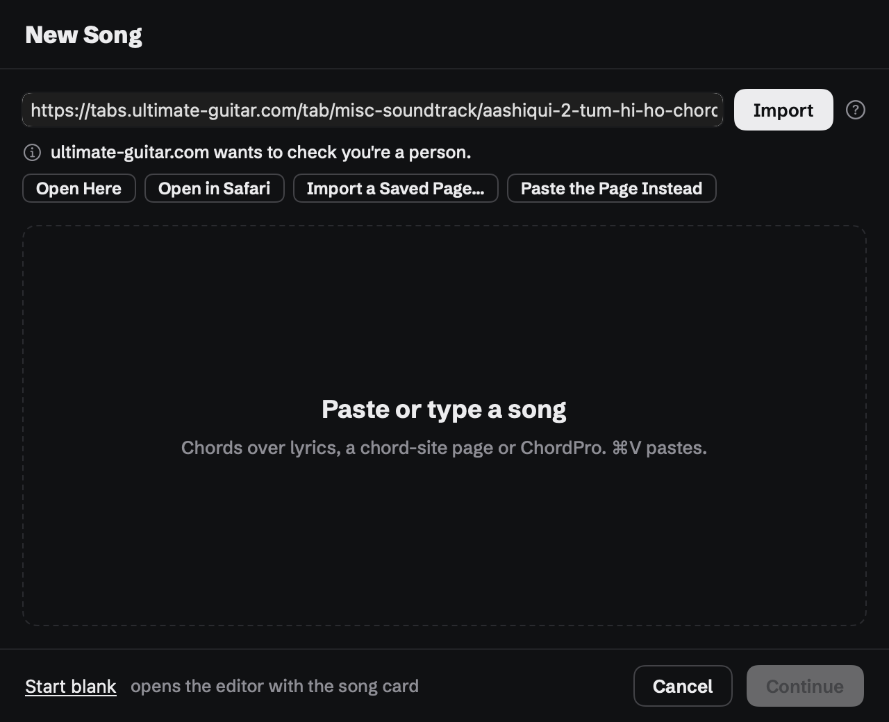
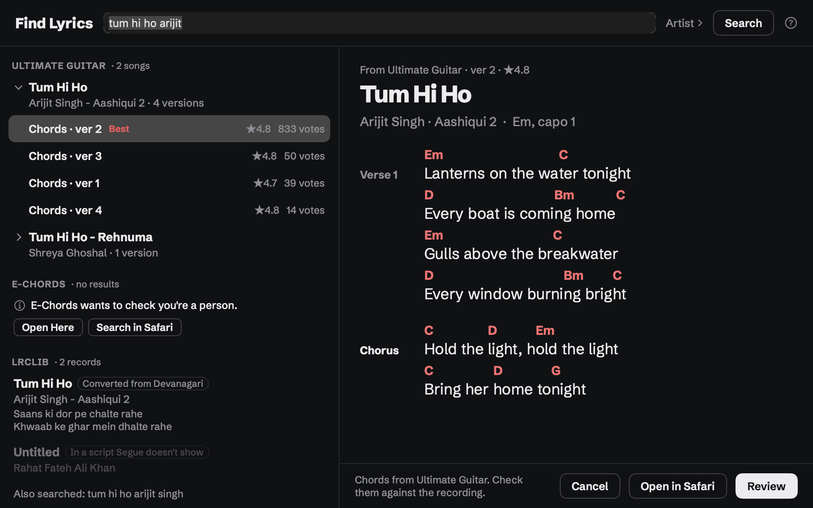
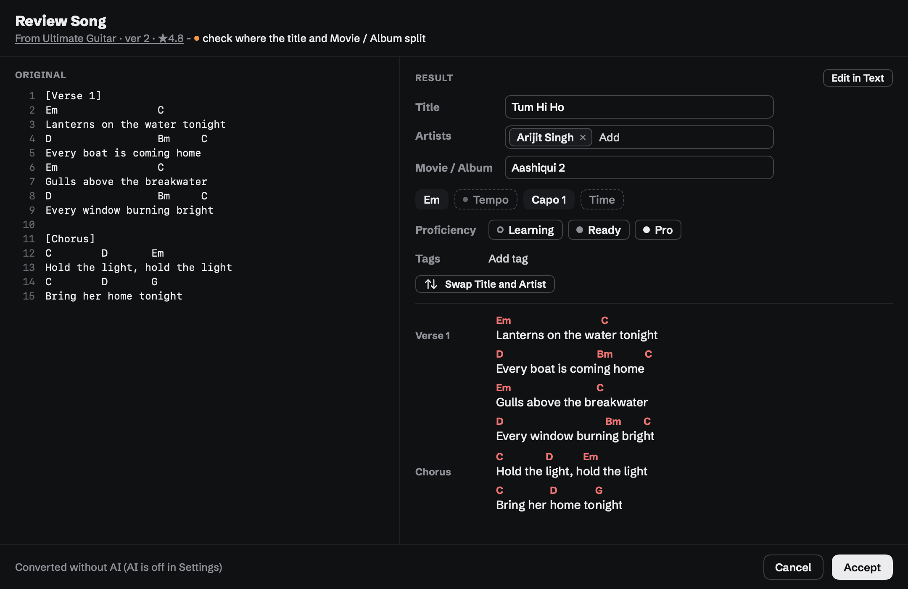
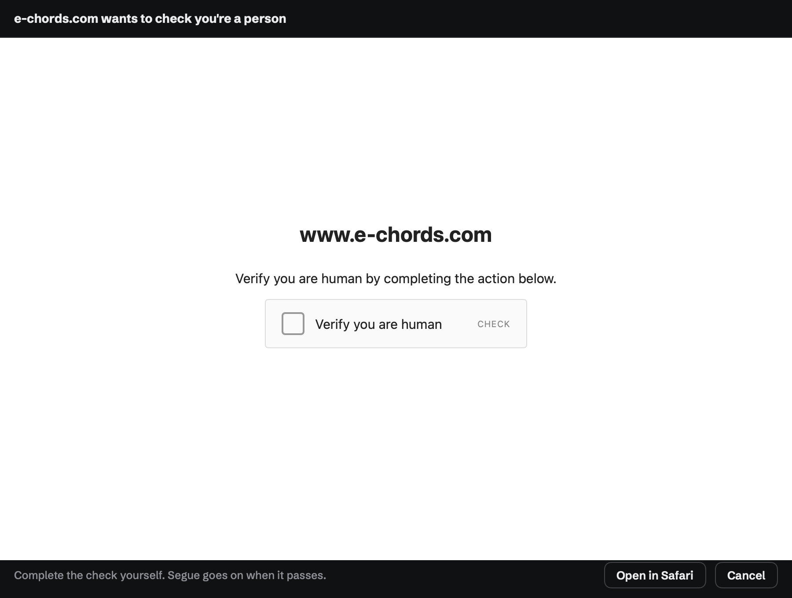

# Import from the web and Find Lyrics

> **Personal build only.** The owner's own guide, kept out of the published user guide: the App Store build has none of these features and there is no public page for them (P9-4 spec 17, R179).

## Import a page by its address

1. Press ⇧⌘U (**File > Import from Web Page…**), or click **Import from a web page** in an empty library. You can also paste a lone address into New Song, press ⌘V on the song list with an address on the clipboard, or drop a link from Safari onto the library.
2. Paste the address into the field above the paste area and press Return. Ultimate Guitar, E-Chords and Chordie each have their own reader; any other page uses the general reader.
3. The song opens in the usual review. The line under the title says where it came from, and whether the general reader or the Devanagari romanizer was used. Nothing is saved until you press **Accept**.

When a page can't be read, the message under the field says why and offers what still works: **Open Here**, **Open in Safari**, **Import a Saved Page…** (save the page in Safari with File > Save As) and **Paste the Page Instead**.

## Find Lyrics

1. Press ⇧⌘L (**File > Find Lyrics…**), type a title, an artist or a line, and press Return. Romanized Hindi works as you spell it; Segue also tries common spellings for LRCLIB and shows them as "Also searched".
2. Results come in three groups, always in this order: Ultimate Guitar, E-Chords, LRCLIB. A chord site's versions sit under their song, best rated first. Use ↑ ↓ to move and ← → to fold a song's versions.
3. The right side previews the chart as it will import. Press **Review** (⌘↩) or double-click to open it in the review.

## When a site asks if you're a person

Segue never clicks a check for you. **Open Here** shows the page in a sheet so you can complete it yourself; the import or search then goes on by itself, and later reads reuse the pass. **Settings > Data > Clear Site Data** forgets it.

